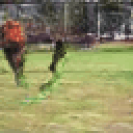
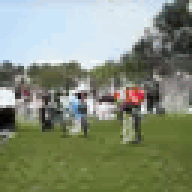
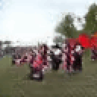
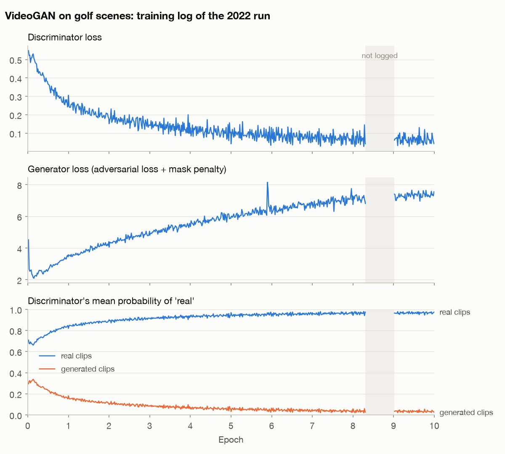

# VideoGAN

[](https://github.com/michaelperez023/VideoGAN/actions/workflows/ci.yml)

A PyTorch study of VideoGAN, the two-stream generative adversarial network from
[Generating Videos with Scene Dynamics](https://arxiv.org/abs/1609.02612) (Vondrick, Pirsiavash
and Torralba, NeurIPS 2016). I trained the GAN from scratch on the MIT golf-course videos with an
A100 GPU, then reused its discriminator as a pretrained network for action recognition on
UCF-101. It was my term project for CAP 6610 Machine Learning at the University of Florida in
Spring 2022; this version reorganizes the code into a tested package and fixes the bugs in the
fine-tuning code.

| End of epoch 3 | End of epoch 6 | End of epoch 9 |
|:---:|:---:|:---:|
|  |  |  |

*Videos generated during the 2022 training run: 32 frames of 64 x 64 pixels, shown at 3x.*

## How VideoGAN works

The generator turns a 100-dimensional noise vector into a 32-frame, 64 x 64 video through two
streams: 3D transposed convolutions produce a moving foreground and a mask, and 2D transposed
convolutions produce one background image that stays fixed over time. The video is
`mask * foreground + (1 - mask) * background`, and an L1 penalty on the mask (weight 0.1) pushes
the generator to draw everything static with the background stream. The discriminator is a
five-layer 3D convolutional network that mirrors the foreground stream and scores each video as
real or generated, and the two networks are trained against each other with Adam (learning rate
2e-4, beta1 0.5). Because the discriminator has to learn what real scenes and real motion look
like, it can be fine-tuned for action recognition by replacing its last layer with a classifier.

## Repository layout

```
videogan/                the Python package
  models.py              generator and discriminator
  data.py                golf-strip and UCF-101 datasets
  video_io.py            video decoding and MP4, GIF and image writing (PyAV, Pillow)
  train.py               GAN training           python -m videogan.train
  finetune.py            UCF-101 fine-tuning    python -m videogan.finetune
  sample.py              video generation       python -m videogan.sample
tests/                   CPU tests on small synthetic datasets
splits/
  ucf101/                official UCF-101 train/test lists (three folds)
  kayaking-yoyo/         two-class subset for the binary experiment
scripts/
  slurm/                 example Slurm jobs for training and fine-tuning
  plot_training_log.py   loss figure from a training log
  make_gifs.sh           README GIFs from sample videos (needs the ffmpeg command)
genvideos/               samples from the end of each epoch of the 2022 run
logs/                    training log of the 2022 run, averaged over 500 iterations
docs/                    course proposal and report (PDF), figures
```

## Setup

Python 3.10 or newer. Install [PyTorch](https://pytorch.org/get-started/locally/) for your
platform, then the package:

```bash
git clone https://github.com/michaelperez023/VideoGAN.git
cd VideoGAN
pip install -e .                # ".[dev]" adds pytest and ruff, ".[plot]" adds matplotlib
```

- Videos are decoded and encoded with [PyAV](https://github.com/PyAV-Org/PyAV), whose wheels
  include FFmpeg, so the package needs no system FFmpeg. Only `scripts/make_gifs.sh` calls the
  `ffmpeg` command; `python -m videogan.sample` writes GIFs without it.
- The tools run on CUDA when it is available and on the CPU otherwise; `--device` picks another.
- Training and fine-tuning accept `--amp` for mixed precision on CUDA GPUs. It has not been tested
  on a GPU yet, so the commands below and the Slurm scripts leave it off.
- Intel Macs: the newest PyTorch for them is 2.2.2, which needs `numpy<2`. With Python 3.12
  there, runs that used data-loading worker processes finished their work but did not exit;
  `--num-workers 0` avoids this.

## Data

**Golf scenes** (GAN training). The stabilized golf-course clips from the paper are on the
authors' server, as an index of 603,776 clips and a 140 GB archive:

```bash
wget -P data/golf https://data.csail.mit.edu/videogan/golf.txt
wget -P data/golf https://data.csail.mit.edu/videogan/golf.tar.bz2
tar -xjf data/golf/golf.tar.bz2 -C data/golf     # creates data/golf/frames-stable-many/
```

Each JPEG in `frames-stable-many/` stores one clip as 128 x 128 frames stacked vertically. The
loader takes the first 32 frames of a clip, resizes them to 64 x 64, and skips clips that are
shorter.

**UCF-101** (fine-tuning). Download `UCF101.rar` (6.9 GB) from the
[UCF-101 page](https://www.crcv.ucf.edu/data/UCF101.php) and extract it, for example with
`unrar x UCF101.rar data/` or `7z x UCF101.rar -odata`, which creates `data/UCF-101/<class>/`.
The train/test lists are already in [`splits/`](splits): `splits/ucf101` holds the official
lists from `UCF101TrainTestSplits-RecognitionTask.zip`, and
[`splits/kayaking-yoyo`](splits/kayaking-yoyo) the two-class subset. Both read from the same
extracted folder, and the loader also finds videos that sit together in one flat folder, so
there is no need to sort them into class folders first.

## Training the GAN

```bash
python -m videogan.train --data-root data/golf --out-dir runs/golf
```

The defaults are the settings of the 2022 run: 10 epochs, batch size 20, Adam with learning rate
2e-4 and beta1 0.5, and mask penalty 0.1. Every 2,000 steps and at the end of each epoch, training
writes a grid of videos for a fixed set of noise vectors to `runs/golf/samples/` and saves
`runs/golf/checkpoints/last.pt`; each epoch also keeps its own checkpoint. The losses are logged
to `runs/golf/train_log.csv` every 100 steps. To continue a run that stopped:

```bash
python -m videogan.train --data-root data/golf --out-dir runs/golf --resume runs/golf/checkpoints/last.pt
```

Resuming restores both networks, both optimizers and the position within the epoch, and drops
the log rows written after the checkpoint, since those steps are trained again. A run that
stopped in the middle of an epoch has to be resumed with the same `--batch-size`, `--seed` and
`--index`, so that the epoch continues in the same clip order. `--resume` also accepts the
`*_state_normal.ckpt` checkpoints that the 2022 code wrote. For a Slurm cluster,
[`scripts/slurm/train.sh`](scripts/slurm/train.sh) runs the same command and resumes on its own
when it is submitted again. `python -m videogan.train --help` lists every option.

## Fine-tuning on UCF-101

```bash
# Kayaking vs. YoYo
python -m videogan.finetune --data-root data/UCF-101 --split-dir splits/kayaking-yoyo \
    --gan-checkpoint runs/golf/checkpoints/last.pt --out-dir runs/kayaking-yoyo

# All 101 classes, official split 1 (--fold 2 or 3 for the others)
python -m videogan.finetune --data-root data/UCF-101 --split-dir splits/ucf101 \
    --gan-checkpoint runs/golf/checkpoints/last.pt --out-dir runs/ucf101
```

The discriminator's last layer is replaced by a new classifier with dropout before it, as in the
paper (rate 0.5 by default here), and the whole network is trained, for 20 epochs by default.
Frames are resized so that their shorter side is 64 pixels. In each epoch, every training video
contributes one random 32-frame clip, randomly cropped to 64 x 64 and mirrored half of the time.
After each epoch the model is evaluated on the whole test list in eval mode, on five evenly
spaced, center-cropped clips per video: clip accuracy scores the clips one by one, and video
accuracy averages their class probabilities. The scores go to `metrics.csv` and the model to
`classifier.pt` in the output folder. There is no separate validation set, so the accuracy to
report is that of the last epoch at the default settings; picking the best epoch from
`metrics.csv` would select the model on the test set. Without `--gan-checkpoint`, the same
network trains from random weights, which is the baseline that the pretrained discriminator
should beat. [`scripts/slurm/finetune.sh`](scripts/slurm/finetune.sh) is a Slurm example.

## Generating videos

```bash
python -m videogan.sample --checkpoint runs/golf/checkpoints/last.pt --out-dir samples --num-videos 16
```

This writes each video as a GIF (or an MP4 with `--format mp4`), its background image, and a grid
of all the videos.

## Results

**Video generation.** The 2022 run trained the GAN for 10 epochs of 30,188 batches of 20 clips
on one NVIDIA A100 of UF's HiPerGator cluster, at about 12 hours per epoch. The GIFs above are
three of its samples, and the samples of all ten epochs are in [`genvideos/`](genvideos). The
training log shows the discriminator gaining the upper hand: its loss falls every epoch while
the generator's rises, and in the last epoch it gives real clips a mean probability of 0.97 of
being real and generated clips 0.03. The first job reached the cluster's 100-hour limit during
epoch 8, and the log of the job that ran epoch 8 again was not kept, which is the gap in the
figure. The averaged log is in [`logs/`](logs).

<picture>
  <source media="(prefers-color-scheme: dark)" srcset="docs/figures/training_loss_dark.png">
  
</picture>

**Action recognition.** No fine-tuning results are reported yet. The 2022 fine-tuning code did
not train the new classifier layer and scored a single batch of test clips, and the 101-class
run stopped on a data-loading error. This version fixes all three, and the accuracy numbers will
be added once the experiments are re-run. For reference, the paper reports 52.1% on UCF-101 with
a discriminator pretrained on more than 5,000 hours of unlabeled Flickr video; here the
discriminator is pretrained on the golf scenes only.

## Development

```bash
pip install -e ".[dev]"
ruff check . && ruff format --check .
pytest
```

The tests run on the CPU with generated JPEG strips and AVI files. They cover the models, both
datasets, video I/O, a short training run with resuming, sampling, and fine-tuning, including
regression tests for the 2022 fine-tuning bugs. [CI](.github/workflows/ci.yml) runs them on
pushes to main and on pull requests.

## Credits

- The model definitions and the GAN training loop are adapted from
  [yhjo09/videogan-pytorch](https://github.com/yhjo09/videogan-pytorch), a PyTorch port of the
  authors' Torch7 code, [cvondrick/videogan](https://github.com/cvondrick/videogan), by way of
  the TensorFlow port [GV1028/videogan](https://github.com/GV1028/videogan). In the 2022 version
  of this project, the training script and the video utilities were that repository's
  `train_golf.py` with small changes and its `utils.py` unchanged. The files adapted from it say
  so at the top.
- The golf dataset comes from the paper's authors, and UCF-101 and its official splits from
  [Soomro, Zamir and Shah (2012)](https://www.crcv.ucf.edu/data/UCF101.php).
- The 2022 fine-tuning scripts also listed
  [Zasder3/Latent-Neural-Differential-Equations-for-Video-Generation](https://github.com/Zasder3/Latent-Neural-Differential-Equations-for-Video-Generation)
  as a reference.

The repository has no license file because the upstream code it adapts was published without
one.

## Citation

```bibtex
@inproceedings{vondrick2016generating,
  title     = {Generating Videos with Scene Dynamics},
  author    = {Vondrick, Carl and Pirsiavash, Hamed and Torralba, Antonio},
  booktitle = {Advances in Neural Information Processing Systems},
  volume    = {29},
  year      = {2016}
}
```

## About this project

This was my term project for CAP 6610 Machine Learning at the University of Florida in Spring
2022. I studied the paper, trained the GAN on UF's HiPerGator supercomputer, and ran the
fine-tuning experiments. The original [project proposal](docs/CAP6610_Machine_Learning_Project_Proposal.pdf)
and [final report](docs/CAP6610_Machine_Learning_Project_Report.pdf) are in `docs/` as
submitted. The report needs two corrections. First, the GAN was trained on the golf dataset, not
on UCF-101 as the abstract says. Second, each binary accuracy in its fine-tuning section was
measured on one batch of 10 test clips with an output layer that had not been trained, and the
24 epochs it describes were 24 mini-batches, so those numbers should not be relied on.
